* Table of Contents
{:toc}

--------------------------------------------------------------------------------------------------------------------

## **Acknowledgements**

* _{List the sources of reused or adapted ideas, code, documentation, and third-party libraries here, with links to the originals.}_

--------------------------------------------------------------------------------------------------------------------

## **Setting up, getting started**

Refer to the guide [_Setting up and getting started_](SettingUp.md).

--------------------------------------------------------------------------------------------------------------------

## **Design**

:bulb: **Tip:** The `.puml` files used to create diagrams are in `docs/diagrams`. Refer to the [_PlantUML Tutorial_ at se-edu/guides](https://se-education.org/guides/tutorials/plantUml.html) to learn how to create and edit diagrams.

### Architecture

The ***Architecture Diagram*** given above explains the high-level design of the App.

The following provides a quick overview of the main components and their interactions.

**Main components of the architecture**

**`Main`** (consisting of classes [`Main`](https://github.com/se-edu/addressbook-level3/tree/master/src/main/java/seedu/address/Main.java) and [`MainApp`](https://github.com/se-edu/addressbook-level3/tree/master/src/main/java/seedu/address/MainApp.java)) is in charge of the app launch and shut down.
* At app launch, it initializes the other components in the correct sequence, and connects them up with each other.
* At shut down, it shuts down the other components and invokes cleanup methods where necessary.

The bulk of the app's work is done by the following four components:

* [**`UI`**](#ui-component): The UI of the App.
* [**`Logic`**](#logic-component): The command executor.
* [**`Model`**](#model-component): Holds the data of the App in memory.
* [**`Storage`**](#storage-component): Reads data from, and writes data to, the hard disk.

[**`Commons`**](#common-classes) represents a collection of classes used by multiple other components.

**How the architecture components interact with each other**

The *Sequence Diagram* below shows how the components interact with each other for the scenario where the user issues the command `delete 1a2b3c4`.

Each of the four main components (also shown in the diagram above),

* defines its *API* in an `interface` with the same name as the Component.
* provides its functionality through a concrete `{Component Name}Manager` class that implements the corresponding API interface.

For example, the `Logic` component defines its API in `Logic.java` and implements it in `LogicManager.java`. Other components interact with a component through its interface rather than its concrete class, preventing them from coupling to that component's implementation, as illustrated in the following partial class diagram.

The sections below give more details of each component.

### UI component

The **API** of this component is specified in [`Ui.java`](https://github.com/se-edu/addressbook-level3/tree/master/src/main/java/seedu/address/ui/Ui.java)

The UI consists of a `MainWindow` and its parts, such as `CommandBox`, `ResultDisplay`, `PersonListPanel`, and `StatusBarFooter`. All of these, including `MainWindow`, inherit from the abstract `UiPart` class, which captures common behavior among classes that represent visible GUI parts.

The `UI` component uses the JavaFX UI framework. The layouts of these UI parts are defined in matching `.fxml` files in `src/main/resources/view`. For example, [`MainWindow.fxml`](https://github.com/se-edu/addressbook-level3/tree/master/src/main/resources/view/MainWindow.fxml) specifies the layout of [`MainWindow`](https://github.com/se-edu/addressbook-level3/tree/master/src/main/java/seedu/address/ui/MainWindow.java).

The `UI` component,

* executes user commands using the `Logic` component.
* listens for changes to `Model` data so that the UI can be updated with the modified data.
* keeps a reference to the `Logic` component, because the `UI` relies on the `Logic` to execute commands.
* depends on some classes in the `Model` component because it displays `Person` objects from the model.

### Logic component

**API** : [`Logic.java`](https://github.com/se-edu/addressbook-level3/tree/master/src/main/java/seedu/address/logic/Logic.java)

Here's a (partial) class diagram of the `Logic` component:

The sequence diagram below illustrates the interactions within the `Logic` component, taking `execute("delete 1a2b3c4")` API call as an example.

:information_source: **Note:** The lifelines for `DeleteCommandParser` and `DeleteCommand` should end at their destroy markers (X), but due to a limitation of PlantUML, they continue to the end of the diagram.

How the `Logic` component works:

1. When `Logic` is called upon to execute a command, the command is passed to an `AddressBookParser` object, which in turn creates a parser that matches the command (e.g., `DeleteCommandParser`) and uses it to parse the command.
1. This results in a `Command` object (more precisely, an object of one of its subclasses e.g., `DeleteCommand`) which is executed by the `LogicManager`.
1. The command can communicate with the `Model` when it is executed (e.g. to delete a person). 
   Note that although this is shown as a single step in the diagram above for simplicity, the code can require several interactions between the command object and the `Model` to complete the operation.
1. The result of the command execution is encapsulated as a `CommandResult` object which is returned from `Logic`.

Here are the other classes in `Logic` (omitted from the class diagram above) that are used for parsing a user command:

How the parsing works:
* When called upon to parse a user command, the `AddressBookParser` class creates an `XYZCommandParser` (`XYZ` is a placeholder for the specific command name, e.g., `AddCommandParser`). The parser uses the other classes shown above to parse the user command and create an `XYZCommand` object (e.g., `AddCommand`). The `AddressBookParser` returns that object as a `Command` object.
* All `XYZCommandParser` classes, such as `AddCommandParser` and `DeleteCommandParser`, implement the `Parser` interface so they can be treated similarly where appropriate, for example during testing.

The `RemarkCommand` follows the UUID-based person-selection API used by `DeleteCommand`. Its parser accepts a
case-insensitive 7-character hexadecimal short UUID and the `r/REMARK` prefix, and its command resolves the matching
person through `Model#getPersonsByShortUuid` across the full address book rather than the filtered display list.

The following focused class diagrams document the two parts of the feature that are easy to miss in the generic
`XYZCommand` diagrams above:

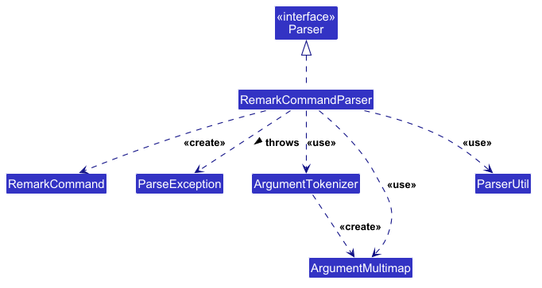

The `RemarkCommandParser` delegates tokenisation and remark validation to the shared parser utilities. It lowercases
the UUID before constructing the command, so UUID input is case-insensitive. Invalid UUIDs and duplicate prefixes are
reported as parse errors before a command reaches the model.

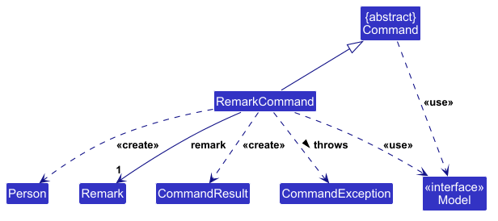

`RemarkCommand` treats a remark update as a replacement of the immutable `Person` value. It first checks that exactly
one person matches the short UUID, creates an edited `Person` carrying over the unchanged fields, and asks the model
to replace the old value. An empty remark is therefore represented by the same command path and removes the existing
remark.

### Model component
**API** : [`Model.java`](https://github.com/se-edu/addressbook-level3/tree/master/src/main/java/seedu/address/model/Model.java)

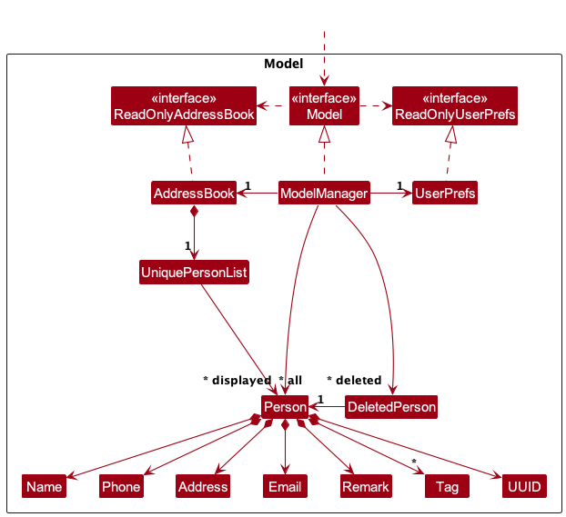

The `Model` component,

* stores the address book data i.e., all `Person` objects (which are contained in a `UniquePersonList` object).
* stores the `Person` objects selected by the current filter, such as search results, in a separate _filtered_ list. It exposes this list as an unmodifiable `ObservableList<Person>` that the UI can observe and bind to, so the UI updates when the list changes.
* stores a `UserPrefs` object that represents the user’s preferences (currently, just the GUI settings). This is exposed to the outside as a `ReadOnlyUserPrefs` object.
* does not depend on any of the other three components (as the `Model` represents data entities of the domain, they should make sense on their own without depending on other components)

:information_source: **Note:** The alternative, arguably more object-oriented, design below keeps a unique list of tags in `AddressBook`, and each `Person` references tags from that list. This lets `AddressBook` maintain one `Tag` object per unique tag instead of each `Person` holding its own `Tag` objects. 

### Storage component

**API** : [`Storage.java`](https://github.com/se-edu/addressbook-level3/tree/master/src/main/java/seedu/address/storage/Storage.java)

The `Storage` component,
* can save both address book data and user preference data in JSON format, and read them back into corresponding objects.
* is implemented by `StorageManager`, which delegates the actual JSON file access to `JsonAddressBookStorage` and `JsonUserPrefsStorage` (one class per data file).
* depends on some classes in the `Model` component (because the `Storage` component's job is to save/retrieve objects that belong to the `Model`)

### Common classes

Classes used by multiple components are in the `seedu.address.commons` package.

--------------------------------------------------------------------------------------------------------------------

## **Implementation**

This section describes some noteworthy details on how certain features are implemented.

### Find command

The `find` command filters the displayed client list by name keywords and/or tags. The following sequence diagram shows a successful search using `find Alice t/friends`.

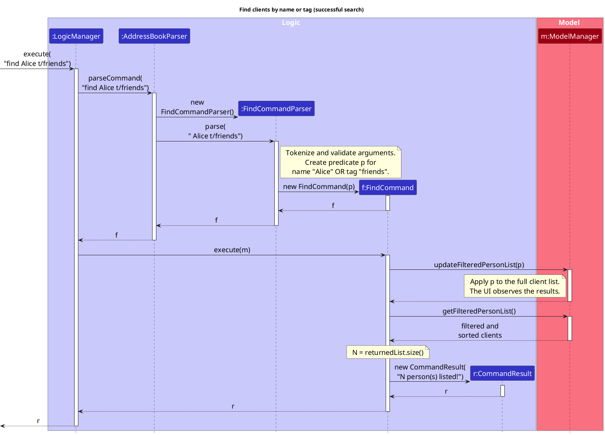

1. `LogicManager` passes the command text to `AddressBookParser`, which delegates the arguments to `FindCommandParser`.
2. `FindCommandParser` trims and normalizes whitespace, then uses `ArgumentTokenizer` to separate name keywords in the preamble from `t/` tag values. It validates each tag using `ParserUtil.parseTag()`.
3. The parser creates a `NameContainsKeywordsPredicate` for a name-only search, or a `NameOrTagContainsKeywordsPredicate` when tags are supplied, and passes that predicate to a new `FindCommand`. Tag-only searches use the latter predicate with an empty name-keyword list.
4. `FindCommand.execute(model)` calls `Model.updateFilteredPersonList(predicate)`. `ModelManager` sets the predicate on its internal `FilteredList`, applying the search to the full client list. Names match any keyword as a case-insensitive substring; tags match any complete tag value, also ignoring case. These conditions are combined with **OR**, so the example matches clients whose names contain `Alice` or whose tags include `friends`.
5. The command reads the size of `Model.getFilteredPersonList()` and returns a `CommandResult` containing the number of matches, including zero when no clients match. The UI observes the filtered and sorted list and displays the matching clients.

Empty arguments or invalid tags cause a `ParseException` during parsing, before a `FindCommand` is created or the displayed list is changed. Finding clients changes the list filter without modifying client records. The diagram focuses on parsing and filtering; the usual `LogicManager` storage save after command execution is omitted. Destruction markers indicate when the temporary parser and command are no longer referenced in this interaction, rather than when Java garbage collection occurs. The `CommandResult` remains alive because it is returned to the caller.

### Remark command

The high-level sequence diagram below shows the parsing path for `remark 1a2b3c4 r/Likes to swim.`. The parser creates
a command from the user's text and delegates the command's execution to a reference frame. The reference frame
abstracts the detailed model interaction shown in the second diagram.

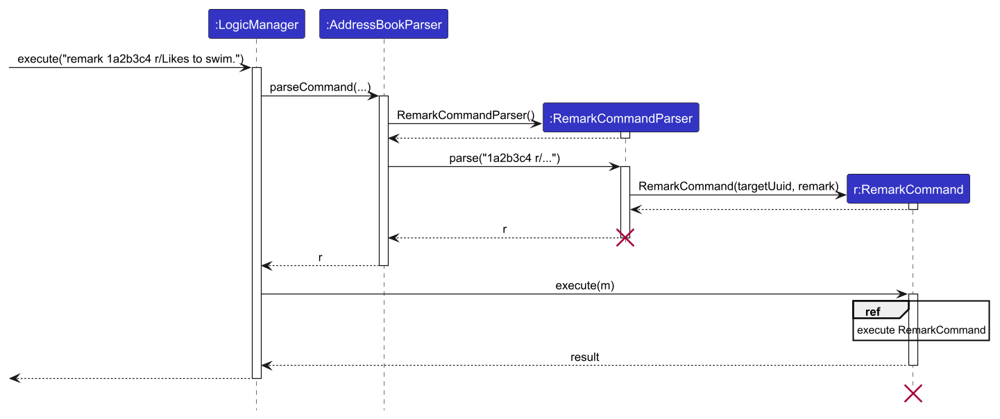

The following diagram expands the `execute RemarkCommand` reference frame. The command obtains the target from the
complete address book, creates a replacement `Person`, updates the model's filtered list, and returns a
`CommandResult`.

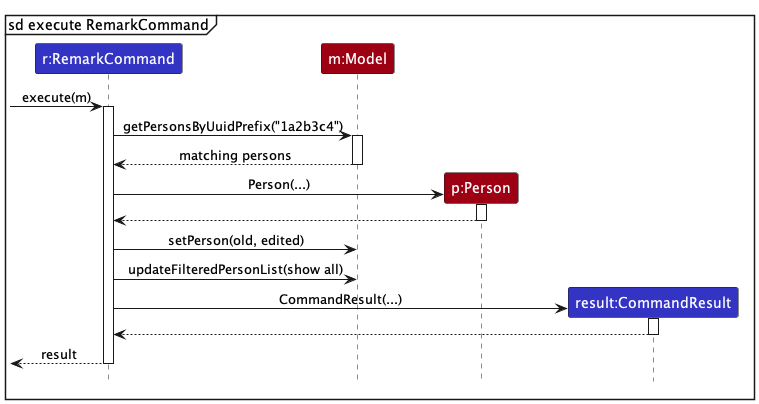

If the UUID matches no person or more than one person, `RemarkCommand` throws a `CommandException` and does not
replace any data. If the `r/` value is empty, the same successful path stores an empty `Remark`, which removes the
displayed remark without requiring a separate command.
### Add command

#### Implementation

The `add` command creates a new `Person` and stores it in the address book. It requires a name,
phone number, email address, and postal address, while tags are optional and may be supplied more
than once.

The main classes involved in the implementation are shown in the following class diagram:

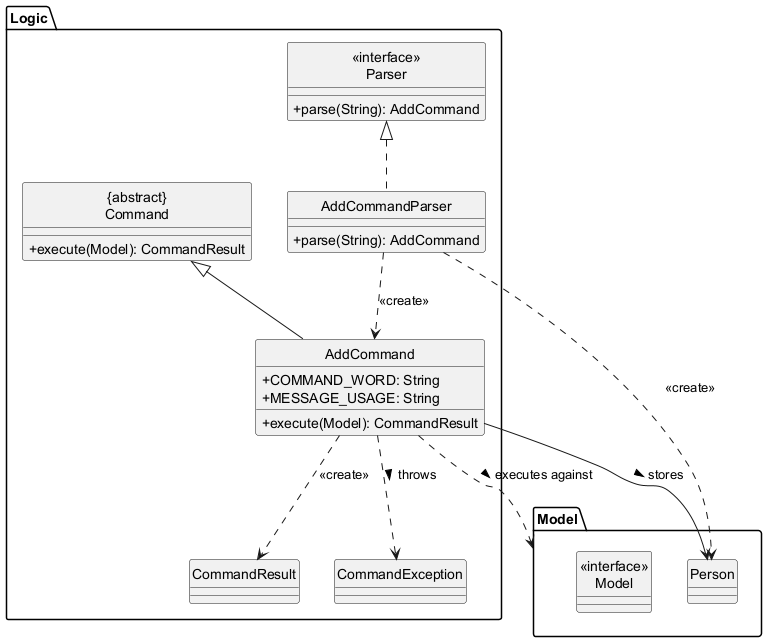

The `add` command flow is split into the following sequence diagrams:

Parsing and validation:

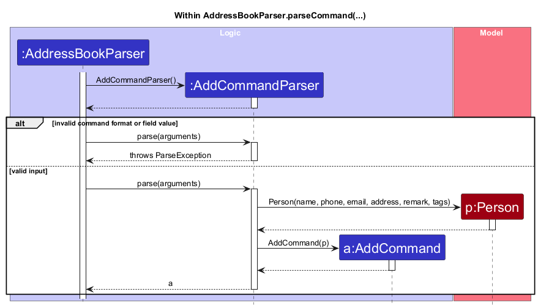

Execution and duplicate detection:

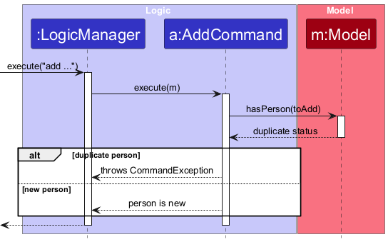

Successful person addition:

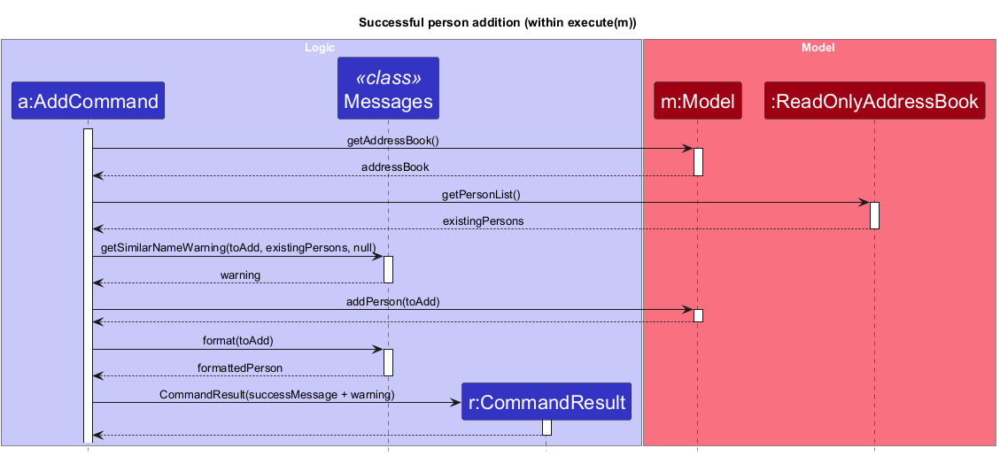

How the `add` command works:

1. `LogicManager` passes the user input to `AddressBookParser`, which creates an
   `AddCommandParser` for the `add` command.
2. `AddCommandParser` tokenizes the input and checks that all required prefixes are present,
   that there is no non-empty preamble, and that non-tag prefixes are not repeated. The tokenizer
   ignores field-looking prefixes inside double-quoted values and rejects unmatched quotes.
3. `ParserUtil` parses each field. The `Name`, `Phone`, `Email`, `Address`, and `Tag` value
   classes validate their respective constraints. Name, phone, email, and address values allow
   punctuation but must be non-blank, control-character-free, and at most 255 Unicode code points.
   Names and phone numbers must contain a letter or digit, while emails must contain `@` or be
   `UNKNOWN`.
   The parser also creates an empty `Remark`
   because a newly added person has no remark, then creates an `AddCommand` containing the
   new `Person`. Missing prefixes, repeated non-tag prefixes, and invalid field values result
   in a `ParseException` instead.
4. During execution, `AddCommand` asks the `Model` whether a person with the same identity
   already exists. If so, it throws a `CommandException` and does not modify the address book.
5. Otherwise, it requests a similar-name warning from `Messages`, adds the person through the
   `Model`, and returns a `CommandResult` containing the success message and any warning.

### Sort command

The `sort` command displays all contacts alphabetically by name, ignoring capitalization.
It requires exactly one direction: `sort A-Z` selects ascending order, while `sort Z-A`
selects descending order. Missing directions, unsupported values, and extra arguments
produce a `ParseException` with usage instructions before the displayed list is changed.

#### Implementation

`AddressBookParser#parseCommand()` delegates sort arguments to `SortCommandParser#parse()`.
The parser trims surrounding whitespace and creates a `SortCommand` with the corresponding
`SortOrder` value, either `ASCENDING` or `DESCENDING`. The command stores this required,
non-null direction in a final field.

When `LogicManager` calls `SortCommand#execute(model)`, the command selects a comparator
using `Person#getName().fullName` and `String.CASE_INSENSITIVE_ORDER`. Descending order
uses the reversed comparator. The command then calls these model operations in order:

1. `Model#updateFilteredPersonList(PREDICATE_SHOW_ALL_PERSONS)` removes any existing filter
   so that all contacts are displayed.
2. `Model#updatePersonListComparator(comparator)` applies the requested alphabetical order.

`ModelManager` maintains a `FilteredList<Person>` over the address book's person list and
a `SortedList<Person>` over that filtered list. `ModelManager#getFilteredPersonList()`
exposes the sorted view to the UI. Updating its comparator notifies the observing
`PersonListPanel`, so the command does not call the UI directly.

Sorting changes the displayed order without rearranging the underlying address book.
The comparator remains active during subsequent additions, edits, and searches in the
same session. `list` shows all contacts while retaining the comparator. Restarting the
application restores the saved order because the comparator is not persisted.

#### Sequence diagram

The following diagram illustrates the successful execution of `sort A-Z`.
The object named `s` is the created `SortCommand`, `r` is its `CommandResult`, and `m`
is the `ModelManager` supplied through the `Model` interface.

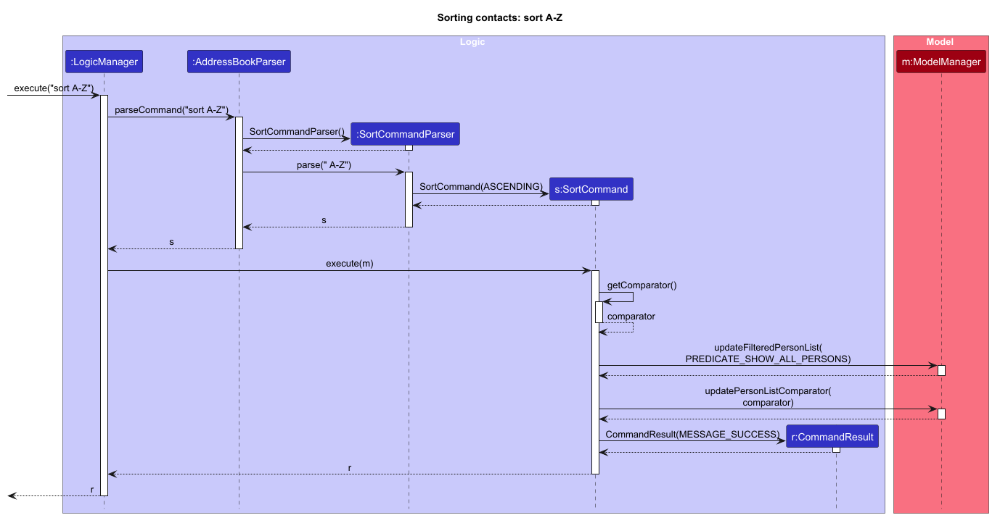

The editable PlantUML source is [SortSequenceDiagram.puml](diagrams/SortSequenceDiagram.puml).
It uses the shared [diagram style](diagrams/style.puml).

The diagram shows `SortCommand#getComparator()` selecting the comparator for the requested direction.
Null checks, contact-count retrieval, assertions, logging, and subsequent storage
interactions are omitted to keep the diagram focused on parsing and sorting.
`sort Z-A` follows the same interaction sequence with `DESCENDING` and a reversed comparator.

#### Defensive checks

`SortCommand` rejects a null sort order during construction
and a null model before execution. Invalid user arguments are handled by `ParseException`,
while assertions check internal postconditions: sorting preserves the contact count,
displays all contacts, and produces the requested order. Assertions require `-ea` when
running the application manually; normal input validation does not depend on assertions.
Diagnostic messages at `FINE` level record the sort direction, contact count, completion,
and rejected input format.

### Undelete feature

#### Implementation

The undelete mechanism is facilitated by `ModelManager`, which keeps a stack, `deletedPersons`, of the persons deleted during the current session. Each entry is a `DeletedPerson` record holding the deleted `Person` and the index in the address book that they were deleted from. `ModelManager` exposes the stack through three `Model` operations:

* `Model#hasDeletedPersons()` — Returns true if there is a deleted person that can be restored.
* `Model#getLastDeletedPerson()` — Returns the most recently deleted person, without restoring them.
* `Model#restoreLastDeletedPerson()` — Reinserts the most recently deleted person at their original index, removes them from the stack, and resets the filtered person list to show all persons.

`Model#deletePerson()` pushes an entry onto the stack after it removes the person, so every successful `delete` can be reversed. `clear` replaces the address book through `Model#setAddressBook()` instead, so it does not add to the stack.

Given below is an example usage scenario and how the undelete mechanism behaves at each step.

Step 1. The user launches the application. `deletedPersons` is empty, so `undelete` fails with an error.

Step 2. The user executes `delete 1a2b3c4` to delete Benson, the 2nd person in the address book. `Model#deletePerson()` pushes `(Benson, 1)` onto `deletedPersons`.

Step 3. The user executes `delete 0f9e8d7` to delete Alice, the 1st person. `Model#deletePerson()` pushes `(Alice, 0)`, which is now on top of `(Benson, 1)`.

Step 4. The user realises that deleting Alice was a mistake, and executes `undelete`. `UndeleteCommand` checks that there is a deleted person to restore, and that no person with the same identity as Alice already exists. It then calls `Model#restoreLastDeletedPerson()`, which reinserts Alice at index 0 and pops `(Alice, 0)` off the stack.

The following sequence diagram shows how the `undelete` command in step 4 goes through the `Logic` and `Model` components:

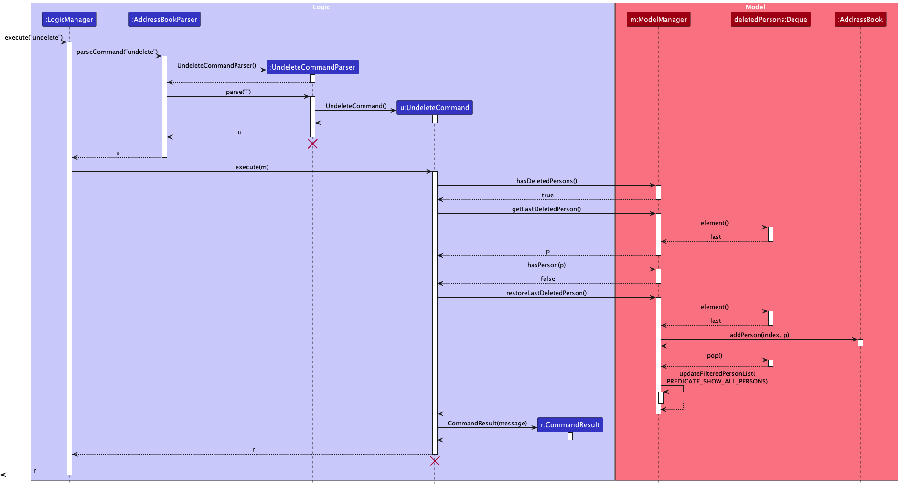

:information_source: **Note:** The lifelines for `UndeleteCommandParser` and `UndeleteCommand` should end at their destroy markers (X), but due to a limitation of PlantUML, they continue to the end of the diagram.

Step 5. The user executes `undelete` again. Benson is reinserted at index 1, so the address book is back in its original order, and `deletedPersons` is empty again.

:information_source: **Note:** If a person with the same name has been added since the delete (e.g. the user re-added Alice by hand), `UndeleteCommand` fails before calling `Model#restoreLastDeletedPerson()`, as restoring the deleted person would leave two persons with the same name. The entry stays on the stack, and the error message tells the user to rename the clashing person with `edit` and run `undelete` again.

:information_source: **Note:** If persons were removed after the delete without going through `Model#deletePerson()` (e.g. by `clear`), the original index can be past the end of the list. `Model#restoreLastDeletedPerson()` then appends the person to the end instead.

`deletedPersons` exists only in memory. It is not saved by `Storage`, and it is not part of `ModelManager#equals()`, so it is lost when the app closes.

#### Design considerations

**Aspect: What is stored to restore a deleted person:**

* **Alternative 1 (current choice):** Store only the deleted person and their index.
  * Pros: Uses little memory, and does not affect any other command.
  * Cons: Only `delete` can be reversed.

* **Alternative 2:** Save a copy of the whole address book before every change, and restore the copy.
  * Pros: Can reverse any command.
  * Cons: Uses memory in proportion to the address book size for every command. Restoring a copy also reverses every command made after it, e.g. reversing a delete would also remove a person added afterwards.

**Aspect: Command word:**

* **Alternative 1 (current choice):** `undelete`.
  * Pros: The name states exactly what it reverses, so users do not expect it to reverse `add` or `edit`.
  * Cons: Users who know `undo` from other applications may try that first.

* **Alternative 2:** `undo`.
  * Pros: Familiar to most users.
  * Cons: Users would expect it to reverse every command, not just `delete`.

**Aspect: Where the restored person is placed:**

* **Alternative 1 (current choice):** At the index they were deleted from.
  * Pros: The list looks exactly as it did before the delete.
  * Cons: The index must be stored, and clamped when the list has since become shorter.

* **Alternative 2:** At the end of the list, like `add`.
  * Pros: Simpler.
  * Cons: The list order changes, and in a long list the restored person is harder to find.

### \[Proposed\] Data archiving

_{Explain here how the data archiving feature will be implemented}_

--------------------------------------------------------------------------------------------------------------------

## **Documentation, logging, testing, dev-ops**

* [Documentation guide](Documentation.md)
* [Testing guide](Testing.md)
* [Logging guide](Logging.md)
* [DevOps guide](DevOps.md)

--------------------------------------------------------------------------------------------------------------------

## **Appendix: Requirements**

### Product scope

**Target user profile**:

* Insurance advisory agent
* Oversees a large contact portfolio
* Highly comfortable with CLI-first, GUI-assisted applications
* Types quickly and intentionally minimises mouse usage
* Prefers dedicated, low latency desktop software over browser-based or mobile apps for productivity and lookup

**Value proposition**: A keyboard-driven, ultra-fast desktop address book that empowers insurance agents to manage and search through high volumes of client portfolios, eliminating mouse friction completely.

### User stories

Priorities: High (must have) - `* * *`, Medium (nice to have) - `* *`, Low (unlikely to have) - `*`

| Priority | As a …​      | I want to …​                                                  | So that I can…​                                                          |
| -------- |-----------------|------------------------------------------------------------------|-----------------------------------------------------------------------------|
| `* * *`  | insurance agent | quickly update client information                                | maintain accurate records of life changes that impact policy coverage needs |
| `* * *`  | insurance agent | sort clients by key parameters                                   | efficiently structure my daily outreach.                                    |
| `* * *`  | insurance agent | view a complete list of all my clients                           | scan key metrics and navigate quickly to specific profiles                  |
| `* * *`  | insurance agent | add a new client with their contact information                  | immediately capture leads and initiate the policy assessment process        |
| `* * *`  | insurance agent | search clients by name                                           | access their profile immediately during real time client interactions       |
| `* * *`  | insurance agent | search client by tag                                             | generate target lists for specialised policy reviews                        |
| `* * *`  | insurance agent | delete client contact                                            | keep my active directory remains free of outdated or redundant contacts     |
| `* * *`  | insurance agent | assign tags to clients                                           | categorise them according to risk profile and product interest              |
| `* *`    | insurance agent | link contacts                                                    | understand family and corporate policy ecosystems                           |
| `* *`    | insurance agent | link individual personal contact information to business details | manage both individual policies and corporate plans seamlessly              |
| `* *`    | insurance agent | restore a client I deleted by mistake                            | recover their details without re-entering them                              |
| `*`      | insurance agent | set reminders for important clients/urgent appointments          | be notified ahead of time for renewals, reviews, or appointments            |

*{More to be added}*

### Use cases

(For all use cases below, the **System** is `ClientConnect` and the **Actor** is the `user` (an insurance agent), unless specified otherwise)

**Use case: UC1 - Add a new client**

**MSS**

1.  User requests to add a client by entering the name, phone, email, address, an optional remark and optional tags.
2.  ClientConnect validates the details.
3.  ClientConnect adds the client and shows a success message with the client's details.

    Use case ends.

**Extensions**

* 1a. The command format is invalid 

    * 1a1. ClientConnect shows an invalid command format error with the correct usage.
    * 1a2. User re-enters the command with the corrected format.

      Steps 1a1-1a2 are repeated until the command format is valid.
      Use case resumes at step 2.

* 2a. One or more field values are invalid (e.g. an email address without `@`, or a tag containing spaces).

    * 2a1. ClientConnect shows the error message for the first invalid field.
    * 2a2. User re-enters the command with a corrected value.

      Steps 2a1-2a2 are repeated until all values are valid.
      Use case resumes at step 3.

* 2b. A client with the same name already exists (case-insensitive, ignoring leading and trailing spaces), and the name is not the placeholder `UNKNOWN`.

    * 2b1. ClientConnect rejects the entry and shows "This name already exists in the address book. Add more details to the name."
    * 2b2. User decides to update the existing client instead (see UC4).

      Use case ends.

**Use case: UC2 - Find a client and retrieve their details during a call**

**MSS**

1.  User requests to find clients by entering one or more name keywords and/or tags (each tag with the `t/` prefix).
2.  ClientConnect shows the matching clients in the list and the number of clients listed.
3.  User reads the required details from the client's card.

    Use case ends.

**Extensions**

* 1a. No keyword is provided.

    * 1a1. ClientConnect shows an invalid command format error with the correct usage.
    * 1a2. User re-enters the command with at least one keyword.

      Steps 1a1-1a2 are repeated until a keyword is provided.
      Use case resumes at step 2.

* 2a. No clients match the keywords.

    * 2a1. ClientConnect shows "0 person(s) listed!" and an empty list.
    * 2a2. User re-enters the command with different keywords (e.g. an alternative spelling).

      Steps 2a1-2a2 are repeated until at least one client matches.
      Use case resumes at step 3.

* 2b. Too many clients match to find the right one quickly.

    * 2b1. User re-enters the command with a single, longer name keyword (e.g. `find Alex` instead of `find Al`).
      Adding separate keywords does not narrow the results because `find` matches any keyword (OR search).

      Use case resumes at step 2.

* 3a. User wants to return to the full client list.

    * 3a1. User requests to list all clients.
    * 3a2. ClientConnect shows all clients.

      Use case ends.

**Use case: UC3 - Delete an obsolete client**

**MSS**

1.  User reads the short UUID shown on the card of the client to delete.
2.  User requests to delete that client by its short UUID.
3.  ClientConnect deletes the client and shows a success message with the deleted client's name.

    Use case ends.

**Extensions**

* 1a. The address book is empty.

    Use case ends.

* 2a. The identifier is not 7 to 32 hexadecimal characters once dashes are removed (e.g. missing, too short, too long or contains non-hex characters).

    * 2a1. ClientConnect shows an invalid command format error with the correct usage.
    * 2a2. User re-enters the command with a valid identifier.

      Steps 2a1-2a2 are repeated until the identifier is valid.
      Use case resumes at step 3.

* 2b. No client's UUID starts with the given identifier.

    * 2b1. ClientConnect shows "No person with UUID: &lt;identifier&gt;".
    * 2b2. User re-enters the command with an identifier that exists.

      Steps 2b1-2b2 are repeated until a matching client is found.
      Use case resumes at step 3.

* 2c. More than one client's UUID starts with the given identifier.

    * 2c1. ClientConnect shows an ambiguity error listing the full UUID and name of each matching client.
    * 2c2. User re-enters the command with enough characters of the intended client's UUID to tell the clients apart.

      Use case resumes at step 3.

**Use case: UC4 - Update an existing client's details**

**MSS**

1.  User searches for the client to update (UC2).
2.  User requests to edit a specific client by its short UUID, providing the fields to change (e.g. a new phone number, remark, or additional tags).
3.  ClientConnect validates the new values.
4.  ClientConnect updates the client and shows a success message with the updated details.

    Use case ends.

**Extensions**

* 1a. The displayed list is empty.

    Use case ends.

* 2a. The short UUID is invalid, unknown, or ambiguous.

    * 2a1. ClientConnect shows an error message.
    * 2a2. User re-enters the command with a valid, sufficiently specific short UUID.

      Steps 2a1-2a2 are repeated until the short UUID identifies exactly one client.
      Use case resumes at step 3.

* 2b. No fields to edit are provided.

    * 2b1. ClientConnect shows an error message stating that at least one field must be provided.
    * 2b2. User re-enters the command with at least one field.

      Steps 2b1-2b2 are repeated until at least one field is provided.
      Use case resumes at step 3.

* 3a. A provided value is invalid.

    * 3a1. ClientConnect shows the error message for the first invalid field.
    * 3a2. User re-enters the command with a corrected value.

      Steps 3a1-3a2 are repeated until all values are valid.
      Use case resumes at step 4.

* 3b. The new name matches another existing client's name (case-insensitive).

    * 3b1. ClientConnect rejects the edit and shows "This person already exists in the address book."
    * 3b2. User re-enters the command with a different name.

      Steps 3b1-3b2 are repeated until the name is unique.
      Use case resumes at step 4.

*{More to be added}*

### Non-Functional Requirements

1.  The application should work on any _mainstream OS_ with Java `25` or above installed.
2.  With up to 1000 client records, adding, editing, finding, deleting, and listing records should each complete within 2 seconds on a computer with at least a dual-core processor and 8 GB of RAM.
3.  An insurance agent should be able to complete the core client-management tasks (add, edit, find, list, and delete) using only the keyboard, without needing to use a mouse.
4.  The command input and search results should remain usable through keyboard navigation, including when a search returns multiple clients.
5.  The application should save each successful change to client data automatically, and saved data should remain available after the application is closed and reopened.
6.  Invalid commands or invalid client data should show an actionable error message without changing existing client records.
7.  The application should be usable without an internet connection and should not transmit client data to an external service during normal use.

### Glossary

* **Mainstream OS**: Windows, Linux, Unix, or macOS
* **Private contact detail**: A contact detail that is not meant to be shared with others
* **Insurance Agent**: Point of contact for insurance products, manages a list of insurance clients' information
* **Insurance Client**: Consumer of insurance products, with an associated insurance agent who has the client's contact information
* **Policyholder**: Insurance client of a specific insurance product, in particular with a purchased policy with an associated policynumber

--------------------------------------------------------------------------------------------------------------------

## **Appendix: Instructions for manual testing**

Given below are instructions to test the app manually.

:information_source: **Note:** These instructions only provide a starting point for testers to work on;
testers are expected to do more *exploratory* testing.

### Launch and shutdown

1. Initial launch

   1. Download the JAR file and copy it into an empty folder.

   1. Double-click the JAR file. 
      Expected: The GUI opens with a set of sample contacts. The window size may not be optimal.

1. Saving window preferences

   1. Resize the window to an optimal size. Move the window to a different location. Close the window.

   1. Relaunch the app by double-clicking the JAR file. 
       Expected: The most recent window size and location are retained.

1. _{ more test cases …​ }_

### Deleting a person

1. Deleting a person by short UUID

   1. Prerequisites: List all persons using the `list` command, with multiple persons in the list. Note the short UUID (`#xxxxxxx`) shown on a contact's card.

   1. Test case: `delete <shortUuid>` (using a short UUID that appears on a card) 
      Expected: The matching contact is deleted, regardless of the current filter. The status message shows the deleted contact's details.

   1. Test case: `delete 9999999` (a well-formed short UUID that no contact has) 
      Expected: No person is deleted. The status message shows `No person with UUID: 9999999`.

   1. Test case: `delete 1` 
      Expected: No person is deleted. The status message shows an invalid command format error, as the identifier must be 7 to 32 hexadecimal characters.

   1. Other incorrect delete commands to try: `delete`, `delete x`, `delete 123456g` (contains a non-hex character), `delete 1a2b3c4 abc` (extra argument) 
      Expected: Similar to previous — an invalid command format error.

1. Deleting one of two persons that share a short UUID

   1. Prerequisites: Close the app. In `data/addressbook.json`, change the `uuid` of two persons so that both start with the same 7 characters but differ afterwards, e.g. `1a2b3c4d-1000-0000-0000-000000000000` and `1a2b3c4d-2000-0000-0000-000000000000`. Relaunch the app.

   1. Test case: `delete 1a2b3c4` 
      Expected: No person is deleted. The status message lists both persons' full UUIDs and names.

   1. Test case: `delete 1a2b3c4d1` 
      Expected: Only the first person is deleted.

   1. Test case: `delete 1a2b3c4d-2000-0000-0000-000000000000` (the full UUID, with dashes) 
      Expected: The second person is deleted.

1. _{ more test cases …​ }_

### Restoring a deleted person

1. Restoring persons after deleting them

   1. Prerequisites: List all persons using the `list` command, with at least two persons in the list. Note the short UUIDs of the first two persons.

   1. Test case: `delete <first person's short UUID>`, then `undelete` 
      Expected: The first person is restored at the top of the list, with the same short UUID. The status message shows `Restored person:` followed by their details.

   1. Test case: `delete <first person's short UUID>`, `delete <second person's short UUID>`, then `undelete` twice 
      Expected: The first `undelete` restores the second person, and the second `undelete` restores the first person. The list is back in its original order.

   1. Test case: `find <a name that matches nobody>` after a delete, then `undelete` 
      Expected: The person is restored, and the list shows all persons.

   1. Test case: `undelete` with no deletes since the app was launched 
      Expected: Nothing is restored. The status message shows `No deleted persons to restore.`

   1. Test case: `undelete 1` 
      Expected: Nothing is restored. The status message shows an invalid command format error.

1. Restoring a person when a person with the same name exists

   1. Prerequisites: Delete a person, e.g. `John Doe`, then add a new person with the same name.

   1. Test case: `undelete` 
      Expected: Nothing is restored. The status message shows `Cannot undelete John Doe: a person with the same name already exists.`, followed by a prompt to rename that person with `edit`.

   1. Test case: Rename the new `John Doe` with `edit`, then `undelete` 
      Expected: The original `John Doe` is restored, with their original short UUID.

### Saving data

1. Dealing with missing/corrupted data files

   1. Test case: Close the app. In `data/addressbook.json`, change one person's `uuid` to `not-a-uuid`. Relaunch the app. 
      Expected: The app starts with an empty address book instead of crashing. The log shows that the data file could not be loaded.

   1. _{Explain how to simulate other missing or corrupted data files and state the expected behavior.}_

1. _{ more test cases …​ }_
