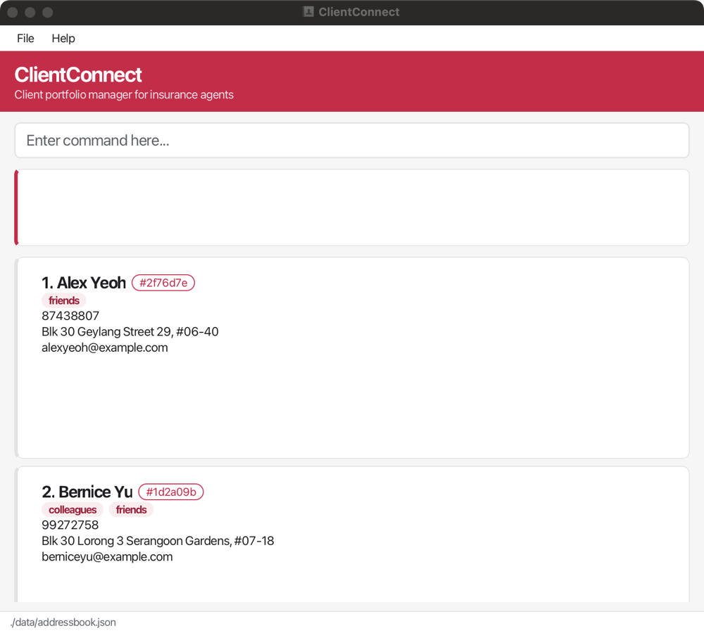
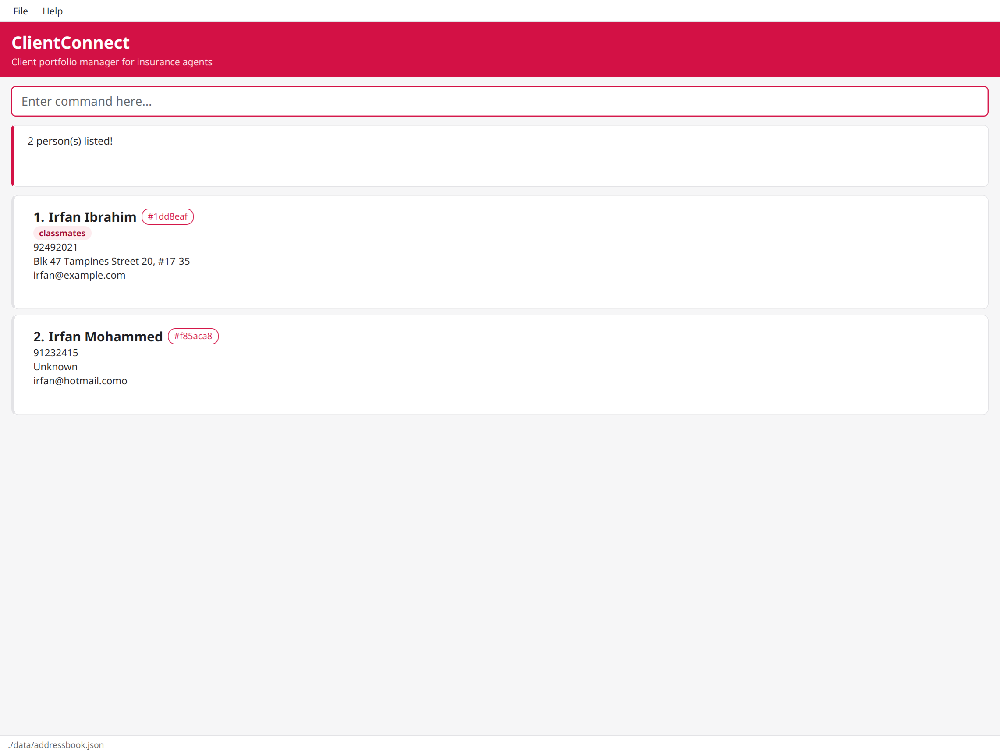

ClientConnect is a **desktop application for insurance agents to manage their client contacts, optimized for use through a Command Line Interface (CLI)** while retaining the benefits of a Graphical User Interface (GUI).

It is built for agents who handle large client portfolios and many active leads. You can record clients, tag them (for example by policy type), add remarks, and find them again by name or tag, all by typing short commands. If you type quickly, ClientConnect lets you manage your clients faster than clicking through forms or scrolling a spreadsheet.

* Table of Contents
{:toc}

--------------------------------------------------------------------------------------------------------------------

## Quick start

1. Ensure that Java `25` or later is installed on your computer. 
   **Mac users:** Ensure you have the precise JDK version prescribed [here](https://se-education.org/guides/tutorials/javaInstallationMac.html).

1. Download the latest `.jar` file from [here](https://github.com/AY2627S1-CS2103T-W08-3/tp/releases).

1. Copy the file to the folder you want to use as the _home folder_ for ClientConnect.

1. Open a terminal, `cd` to the folder containing the JAR file, and run `java -jar ClientConnect.jar`. 
   A GUI similar to the one below should appear in a few seconds. Note how the app contains some sample data. 
   

1. Type a command in the command box and press Enter to execute it. For example, type **`help`** and press Enter to open the help window. 
   Some example commands you can try:

   * `list` : Lists all contacts.

   * `add n/John Doe p/98765432 e/johnd@example.com a/John street, block 123, #01-01` : Adds a contact named `John Doe`.

   * `delete 1a2b3c4` : Deletes the contact whose card shows the short UUID `#1a2b3c4`.

   * `remark 1a2b3c4 r/Likes to swim.` : Adds a remark to the contact whose card shows `#1a2b3c4`.

   * `clear` : Deletes all contacts.

   * `exit` : Exits the app.

1. Refer to the [Features](#features) section below for details of each command.

--------------------------------------------------------------------------------------------------------------------

## Features

**:information_source: Notes about the command format:** 

* Words in `UPPER_CASE` are the parameters to be supplied by the user. 
  For example, in `add n/NAME`, replace `NAME` with a value such as `John Doe`.

* Items in square brackets are optional. 
  For example, `n/NAME [t/TAG]` can be used as `n/John Doe t/friend` or as `n/John Doe`.

* Items followed by `…`​ can appear zero or more times. 
  For example, `[t/TAG]…​` may be omitted, or written as `t/friend` or `t/friend t/family`.

* Parameters can be in any order. 
  For example, if the command specifies `n/NAME p/PHONE_NUMBER`, `p/PHONE_NUMBER n/NAME` is also acceptable.

* Extraneous parameters for commands that take no parameters, such as `help`, `list`, `exit`, and `clear`, are ignored. 
  For example, `help 123` is interpreted as `help`.

* If you are using a PDF version of this document, be careful when copying and pasting commands that span multiple lines as space characters surrounding line-breaks may be omitted when copied over to the application.

### Viewing help: `help`

Shows a message explaining how to access the help page.

Format: `help`

### Adding a person: `add`

Adds a person to the address book.

Format: `add n/NAME p/PHONE_NUMBER e/EMAIL a/ADDRESS [t/TAG]…​ [r/REMARK]`

Names, phone numbers, email addresses, and postal addresses may contain punctuation.
Values must not be blank, contain control characters, or exceed 255 characters.
Names and phone numbers must contain a letter or digit; emails must contain `@` or be `UNKNOWN`.
If a field value contains a prefix such as `p/`, `e/`, or `a/` after a space, wrap the entire value in double quotes.
For example: `n/"ACME p/Research"`.
If information is currently unknown, type `UNKNOWN` into the field. `UNKNOWN` is currently just a standard
indicator for unknown values and does not have any special properties in the stored details. The `add` command
allows multiple entries whose name is exactly `UNKNOWN`; other names must remain unique.
Remarks can be added with the optional `r/REMARK` field.

For example, a phone number can be entered as:
`1234 5678 (HP) 1111-3333 (Office)` or `UNKNOWN`.

For example, email addresses can be entered as:
`peter@example.com (Work) jane@example.com (Personal)`.

:bulb: **Tip:**
A person can have any number of tags, including zero.

Examples:
* `add n/John Doe p/1234 5678 (HP) 1111-3333 (Office) e/johnd@example.com (Work) jane@example.com (Personal) a/John street, block 123, #01-01`
* `add n/Betsy Crowe t/friend e/betsycrowe@example.com a/Newgate Prison p/1234567 t/criminal`
* `add n/John Doe p/12345678 e/john@example.com a/311, Clementi Ave 2 r/Likes to swim.`

### Listing all persons: `list`

Shows a list of all persons in the address book.

Format: `list`

### Sorting all persons lexicographically: `sort`

Displays all persons by name in ascending or descending text order, ignoring capitalization.
Use `asc` for ascending order or `desc` for descending order. Direction parameters are case-insensitive.
Names are compared character by character (lexicographically), so numbers are treated as text:
`Client 10` appears before `Client 2` in ascending order. Symbols follow the comparator's character ordering.
Missing or invalid parameters produce an error without changing the displayed list.

Format: `sort asc` or `sort desc`

### Editing a person: `edit`

Edits an existing person in the address book.

Format: `edit SHORT_UUID [n/NAME] [p/PHONE_NUMBER] [e/EMAIL] [a/ADDRESS] [r/REMARK] [t/TAG]…​`

Names, phone numbers, email addresses, and postal addresses may contain punctuation, subject to the same blank,
control-character, and 255-character safeguards as `add`. Quote values containing field prefixes after a space.

* Edits the person whose short UUID matches `SHORT_UUID`. The short UUID is the 7-character code shown as `#xxxxxxx` on the person's card and is case-insensitive.
* The UUID is matched against every person in the address book, not just the currently displayed list.
* At least one of the optional fields must be provided.
* Existing values will be updated to the input values.
* To update or clear a remark, provide `r/REMARK` or `r/` respectively.
* When editing tags, all of the person's existing tags are removed; adding tags is not cumulative.
* To remove all of a person's tags, enter `t/` without a tag after it.

Examples:
*  `edit 1a2b3c4 p/91234567 e/johndoe@example.com` Edits the phone number and email address of the person whose card shows `#1a2b3c4`.
*  `edit 1a2b3c4 n/Betsy Crower r/Likes to swim.` Updates the name and remark of that person.

### Adding or removing a remark: `remark`

Adds or updates a remark for an existing person in the address book. The existing remark will be overwritten.

Format: `remark SHORT_UUID r/REMARK`

* Updates the remark of the person whose short UUID matches `SHORT_UUID`.
* The short UUID is the 7-character code shown as `#xxxxxxx` on the person's card.
* `SHORT_UUID` **must be 7 hexadecimal characters** (`0`–`9`, `a`–`f`); it is case-insensitive.
* The match is made against every person in the address book, not just the currently displayed list.
* The `r/` prefix is compulsory. Omitting it results in an invalid command.
* To remove an existing remark, enter `r/` without any text after it.

Examples:
* `remark 1a2b3c4 r/Likes to swim.` adds a remark to the contact whose card shows `#1a2b3c4`.
* `remark 1a2b3c4 r/` removes the remark from the contact whose card shows `#1a2b3c4`.
### Name typo warnings

When adding a person or editing a person's name, AddressBook compares the new name with existing names and may display a non-blocking warning when it finds a likely typo. For example, entering `Jon Smith` when `John Smith` already exists produces a warning naming `John Smith` as a possible match.

The comparison:

* ignores leading and trailing spaces, repeated internal spaces, and letter case;
* preserves punctuation when comparing names;
* requires at least three characters and uses a stricter similarity requirement for short names;
* checks only the person's name, not phone numbers, email addresses, addresses, remarks, or tags; and
* does not warn for a case-only match, an exact duplicate, or the person currently being edited.

Additional or misplaced spaces are flagged separately. For example, `John  Smith` may warn about the existing `John Smith`.

The warning is advisory only. The add or edit command is still completed and the input is saved; AddressBook does not ask for confirmation. If the warning identifies the intended existing person, review the result and correct it with another command if necessary. If the new entry is intentional, no further action is required.

### Locating persons by name or tag: `find`

Finds persons whose names contain any given name keyword or whose tags match any given tag.

Format: `find [KEYWORD [MORE_KEYWORDS]...] [t/TAG]...`

Supply at least one name keyword or tag. Put name keywords before any `t/` prefixes.

* The search is case-insensitive; for example, `hans` matches `Hans`.
* Keyword order does not matter; for example, `Hans Bo` matches `Bo Hans`.
* Keywords without a prefix search only names. Each `t/TAG` searches only tags.
* Name keywords match any part of a name; for example, `Han` matches `Hans` and `Johann`.
* Tags are case-insensitive and must match completely; `t/friends` matches `Friends` but not `bestfriends`.
  Use one `t/` prefix per tag. Empty tags and tags containing spaces or punctuation are invalid.
* Persons matching at least one keyword are returned (an `OR` search); for example, `Hans Bo` returns `Hans Gruber` and `Bo Yang`.
* OR matching is automatic when you enter multiple keywords; separate them with spaces.
  This helps when you misremember part of a name, as only one keyword needs to match.
* Name keywords and tags are also combined using OR. A person matching any term appears once in the results.

Examples:
* `find Irfan` and `find irfan` return the same results because search is case-insensitive.
  With the sample data, both return only `Irfan Ibrahim`.
  After adding a person named `Irfan Mohammed`, both return `Irfan Ibrahim` and `Irfan Mohammed`, as shown below. 
  
* `find Irfan Ibrahim` returns `Irfan Mohammed` and `Ismail Ibrahim`, if present,
  because either `Irfan` or `Ibrahim` matches. It also returns `Irfan Ibrahim`, if present.
* `find t/friends` returns persons tagged `friends`.
* `find t/friends t/colleagues` returns persons tagged either `friends` or `colleagues`.
* `find Irfan t/friends` returns persons whose names contain `Irfan` or who have the `friends` tag.

### Deleting a person: `delete`

Deletes the specified person from the address book.

Format: `delete SHORT_UUID`

* Deletes the person whose short UUID matches `SHORT_UUID`.
* The short UUID is the 7-character code shown as `#xxxxxxx` on each person's card. Type it without the `#`.
* `SHORT_UUID` **must be 7 hexadecimal characters** (`0`–`9`, `a`–`f`); it is case-insensitive.
* If two persons share a short UUID, type more characters of the UUID, up to all 32, to pick one. Dashes are ignored, so you can also paste a person's full UUID.
* The match is made against **every** person in the address book, not just the currently displayed list, so filtering with `find` does not affect which person is deleted.

Examples:
* `delete 1a2b3c4` deletes the person whose card shows `#1a2b3c4`.
* `delete 1a2b3c4d1` deletes the person whose UUID starts with `1a2b3c4d1`, when two persons share the short UUID `#1a2b3c4`.

Errors:
* If no person has that UUID prefix, the command fails with `No person with UUID: 1a2b3c4`.
* If more than one person matches, the command fails and lists the full UUID and name of each match. Enter enough characters of the UUID to tell them apart.

:bulb: **Tip:**
Two persons sharing a short UUID is very rare, so `delete` with the short UUID from the card is almost always enough.

### Clearing all entries: `clear`

Clears all entries from the address book.

Format: `clear`

### Restoring a deleted person: `undelete`

Restores the most recently deleted person, in case you deleted the wrong one.

Format: `undelete`

* The person is restored with the same short UUID, at the position in the list they were deleted from.
* Running `undelete` again restores the person deleted before that, and so on, back to the first delete since the app was opened.
* After a restore, the list shows all persons, so the restored person is always visible.
* `undelete` only reverses `delete`. It does not reverse `clear`, `add`, `edit` or other commands.
* Deleted persons can only be restored until the app is closed.
* `undelete` takes no parameters. Anything typed after it is treated as an invalid command format.

Examples:
* `delete 1a2b3c4` followed by `undelete` restores the person whose card showed `#1a2b3c4`.

Errors:
* If there is no deleted person to restore, the command fails with `No deleted persons to restore.`
* If a person with the same name has been added since the delete, the command fails with `Cannot undelete NAME: a person with the same name already exists.` and nothing is restored, because two persons cannot share a name. Rename that person with `edit`, then run `undelete` again.

### Exiting the program: `exit`

Exits the program.

Format: `exit`

### Saving the data

ClientConnect automatically saves data after every command. You do not need to save manually.

### Editing the data file

ClientConnect data is saved automatically as a JSON file `[JAR file location]/data/addressbook.json`. Advanced users are welcome to update data directly by editing that data file.

:exclamation: **Caution:**
If your changes make the data file invalid, ClientConnect starts with an empty address book at the next run. The invalid file remains on disk until you run a command (ClientConnect saves after every command). Still, we recommend backing up the file before editing it. 
Furthermore, certain edits can cause ClientConnect to behave in unexpected ways (e.g., if a value entered is outside of the acceptable range). Therefore, edit the data file only if you are confident that you can update it correctly.

### Archiving data files `[coming in v2.0]`

_Details coming soon ..._

--------------------------------------------------------------------------------------------------------------------

## FAQ

**Q**: How do I transfer my data to another computer? 
**A**: Install the app on the other computer and overwrite the data file it creates with the data file from your previous ClientConnect home folder.

--------------------------------------------------------------------------------------------------------------------

## Known issues

1. **When using multiple screens**, if you move the application to a secondary screen, and later switch to using only the primary screen, the GUI will open off-screen. The remedy is to delete the `preferences.json` file created by the application before running the application again.
2. **If you minimize the Help Window** and then run the `help` command (or use the `Help` menu, or the keyboard shortcut `F1`) again, the original Help Window will remain minimized, and no new Help Window will appear. The remedy is to manually restore the minimized Help Window.

--------------------------------------------------------------------------------------------------------------------

## Command summary

Action | Format, Examples
--------|------------------
**Add** | `add n/NAME p/PHONE_NUMBER e/EMAIL a/ADDRESS [t/TAG]…​ [r/REMARK]`   e.g., `add n/James Ho p/22224444 e/jamesho@example.com a/123, Clementi Rd, 1234665 t/friend t/colleague`
**Clear** | `clear`
**Delete** | `delete SHORT_UUID`  e.g., `delete 1a2b3c4`
**Edit** | `edit SHORT_UUID [n/NAME] [p/PHONE_NUMBER] [e/EMAIL] [a/ADDRESS] [r/REMARK] [t/TAG]…​`  e.g., `edit 1a2b3c4 n/James Lee e/jameslee@example.com`
**Exit** | `exit`
**Find** | `find [KEYWORD [MORE_KEYWORDS]…​] [t/TAG]…​`  e.g., `find James t/friends`
**Help** | `help`
**List** | `list`
**Remark** | `remark SHORT_UUID r/REMARK`  e.g., `remark 1a2b3c4 r/Likes to swim.`
**Sort** | `sort asc` or `sort desc`
**Undelete** | `undelete`
